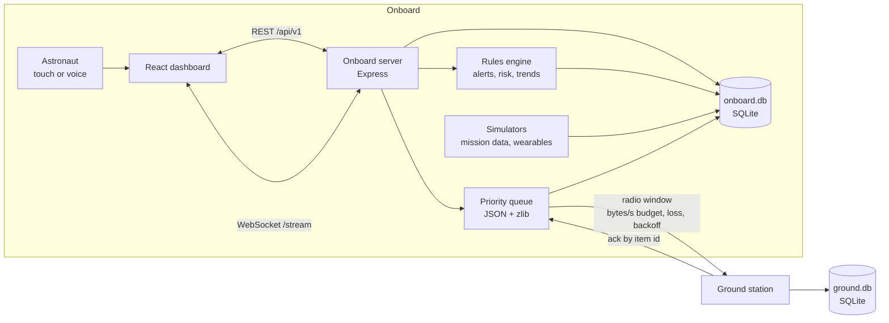
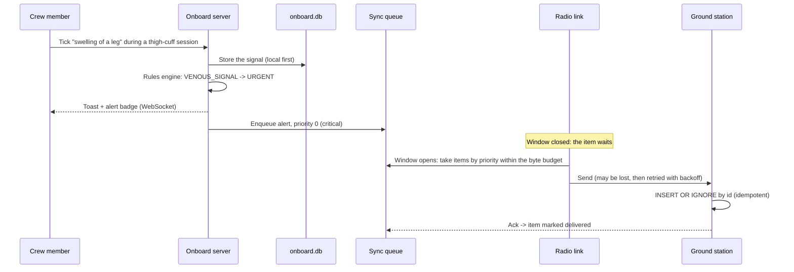

# Architecture

SANS Guardian runs entirely on the spacecraft's local network. Everything is written to local storage first; the ground receives data opportunistically during radio windows.

## Components

## Data flow for one event

## Server modules (`server/src`)

| Module | Role |
|---|---|
| `config.js` | Loads `config/protocol.json` (all demo values) and mission-day helpers |
| `simulation.js` | Deterministic simulated crew: OCT, refraction, IOP, visual field, daily logs, supplements, sessions, wellbeing |
| `db.js` | SQLite schema (built-in `node:sqlite`), seeding, read helpers filtered by mission day |
| `crypto.js` | AES-256-GCM encryption of the genetic profile; only decrypted when consent is recorded |
| `services/trends.js` | Series vs baseline, rolling slope, threshold levels |
| `services/adherence.js` | Supplement schedule (L-180 to R+30), 7/30-day adherence, calendar |
| `services/risk.js` | Explainable 0-100 follow-up priority (genetics with consent, duration, adherence, trend) |
| `services/alerts.js` | Readable rules: retina, refraction, IOP, venous signal, adherence, overdue exam, persistent change |
| `services/ocular.js` | Exam calendar, spare-glasses suggestion, post-flight recovery |
| `services/views.js` | Read models for the dashboard and the reports |
| `sync/queue.js` | Persistent prioritised queue, zlib payloads, backoff |
| `sync/radio.js` | Radio window simulator: periodic windows, byte budget, packet loss |
| `sync/ground.js` | Ground station storing into `ground.db`, idempotent by item id |
| `voice/parser.js` | Closed-vocabulary command parser (English + French equivalents), refuses medical questions |
| `vitals/*` | Live wearable simulator and explainable vitals rules |

## Design choices

- **Mission clock.** The server stores the current mission day; every query only sees what has happened by that day. This lets the demo replay the whole mission and keeps the logic identical to a real-time deployment.
- **Alerts are computed, not hand-written.** Rules are evaluated from the data, so they are reproducible and explainable. Acknowledgements are stored separately. New alerts are queued for the ground as critical items.
- **Strict priority on the link.** Critical alerts always go first; a lost packet is retried after an exponential backoff without blocking other items.
- **Two client contexts.** Slow app state (data revision, selection) and the 1 Hz live stream are separate React contexts, so animated charts are not re-rendered every second.
- **Offline by construction.** Fonts are bundled, icons are inline SVG, the background is a local WebGL shader, and the production build is served by the onboard server.

## Where real systems would plug in

- **Transport:** replace the loopback transport in `server/index.js` with an MQTT (QoS 1) or DTN client; the queue already provides ids, priorities, retries and acks.
- **Voice:** replace the browser speech engine with Faster-Whisper (speech-to-text) and Piper (text-to-speech) running locally; the parser and actions stay the same.
- **Data:** replace `simulation.js` with imports from onboard OCT, tonometry and wearables, keeping the same tables.
